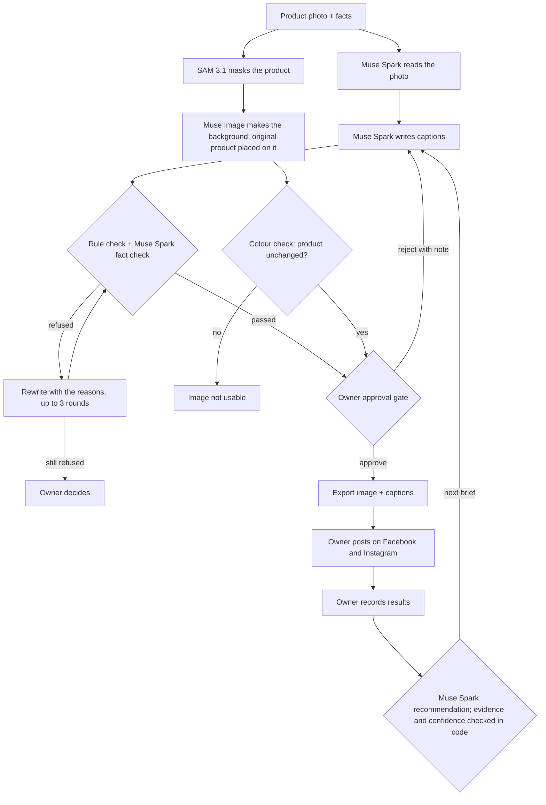

# Muse GrowthPilot

AI-assisted social campaigns for small businesses with no marketing history: product
in → Facebook and Instagram campaigns out → owner approves → publish/export → measure →
evidence-backed next campaign. Built on Meta's Muse Spark, Muse Image and SAM 3.1.

Built for the Meta AI Developer Hackathon (Oct 19 – Nov 4, 2026).

**Pre-existing work:** nothing pre-existing. Everything in this repository was built
during the hackathon.

## Setup

Requires Python 3.10+ and a Meta Model API key.

```bash
python3 -m venv .venv
.venv/bin/pip install -r requirements.txt
cp .env.example .env   # then add your MODEL_API_KEY
```

## Make a verified campaign

```bash
.venv/bin/python -m growthpilot.campaign --business cases/input/demo_business.json \
    --product demo-saree --photo path/to/product.jpg \
    --brief "Festive season: introduce this saree"
```

For each product, GrowthPilot:

1. **Muse Spark** reads the photo and lists what it can't verify (material, weave, origin).
2. **Muse Spark** writes Hindi and English caption variants that cite the facts they use.
3. **Verification** refuses unconfirmed facts, prices and offers, and malformed hashtags
   (plain code). A second **Muse Spark** call refuses factual claims the facts don't
   support. Refused drafts are rewritten with the reasons, up to 3 rounds.
4. **SAM 3.1** masks the product. **Muse Image** generates only the background. The
   original product pixels are placed on it, so the image model never touches the
   product, and a colour check proves it.
5. The output in `cases/output/<run>/` holds `report.md` for the owner to approve, the images,
   `campaign.json`, and `trace.jsonl` with every model call and check. Nothing is
   published.

### Agent mode

Add `--agent` and Muse Spark plans each step itself (plan → act → observe) using the
instructions in [agent/system_instructions.md](agent/system_instructions.md). Its tools are
`analyze_product`, `write_captions`, `make_creatives`, `ask_owner`, `submit_campaign` and
`stop`. It can't skip verification: captions only come from `write_captions`, which returns
verified ones, and `submit_campaign` refuses an incomplete campaign. A tool that fails 3
times in a row, or the 15-turn limit, stops the run and hands it to the owner. The
checklist and every step are saved to `progress.json` each turn and shown in `report.md`.
The agent can't confirm facts; only the owner can.

Business data is JSON. See [cases/input/demo_business.json](cases/input/demo_business.json) (synthetic).
Facts are `confirmed`, `visible` or `unconfirmed`; copy may only state the first two.

## Owner approval

```bash
.venv/bin/python -m approval.app --business cases/input/demo_business.json --owner "Owner"
```

Opens http://127.0.0.1:5000 (this computer only). For each campaign the owner sees the
images with their product check, the captions for Instagram and Facebook, what
verification caught, the agent's steps and every model call. The owner can:

- **Approve** one image and one caption. The gate in [approval/gate.py](approval/gate.py)
  only accepts an image that passed the product check and a caption that still passes
  today's rules and facts. Approval exports the image, `instagram.txt`, `facebook.txt` and
  `approval.json` to `cases/output/<run>/export/` for the owner to post.
- **Reject** with a note, and optionally ask the agent for a new draft that follows it.
- **Answer questions**: say whether an unconfirmed claim is true, or add a fact in their
  own words. Answers are saved to the business file and used from the next draft on.



### Results and the next campaign

The **Results** page records each post's or ad's numbers as read from Meta Business Suite
or Ads Manager, with the source and who recorded them (blank means not read; nothing is
estimated). Rates such as engagement rate and cost per message are computed from them.
Results are kept next to the business file in `<name>.results.json`.

**Recommend the next campaign** asks Muse Spark what the results show and what to try
next, then checks the answer in code
([agent_kit/tools/recommend.py](agent_kit/tools/recommend.py)):

- Every piece of evidence must name a recorded result and a number that matches it;
  anything else is dropped and shown as dropped.
- Confidence is capped by the data: low below 3 results or reach under 300, medium below
  5 results or reach under 1,000.
- The suggested campaign must follow the business rules (no prices or offers) and name a
  real product.

**Make this campaign** sends the recommendation to the agent as the next brief (campaign
B), which goes through the same verification and approval.

Limits (rewrite rounds, agent turns, failures before escalating, colour tolerance) are
set per business under `limits` in the business file.

## Evaluation

[evaluations/cases.json](evaluations/cases.json) holds 14 synthetic products: 12 traps
(unconfirmed or denied facts, and briefs that ask for a sale, scarcity, a delivery promise
or a health claim) and 2 controls. Each case lists the claims no caption may make, with
English and Hindi patterns that GrowthPilot's own checks never see.

```bash
.venv/bin/python -m evaluations.run
```

Latest run (29 Oct 2026, Muse Spark 1.3, 3 captions per case,
[full report](evaluations/results/summary.md)):

| Measure | Result |
|---|---|
| Muse Spark alone, plain prompt: captions with an unsupported claim | 32/36 (89%), in 12 of 12 trap cases |
| **GrowthPilot: accepted captions with an unsupported claim** | **0/36 (0%)** |
| Drafts refused and rewritten (rule check / Muse Spark claim check) | 4 / 24; 8 cases fixed by rewriting |
| Escalated to the owner | 0 cases |
| Control captions accepted (over-blocking) | 6/6 |
| Time and Muse Spark cost per campaign (captions) | 58 s, $0.067 |

Limits: synthetic products, one run, captions only (images are checked separately by the
colour test), and patterns can miss a paraphrase; every match is listed in the report for
a person to judge. Building the set also found real problems that are now fixed: the claim
check refused colours visible in the photo and the business's own name.

## Tests

```bash
.venv/bin/python -m pytest
```

Offline: a fake model stands in for the API.

## Smoke test

One call each to Muse Spark, Muse Image and SAM 3.1:

```bash
python3 scripts/smoke_test.py path/to/product.jpg "the necklace"
```

Outputs go to `scripts/smoke_out/` (not committed).

## Project layout

| Folder | Responsibility |
|---|---|
| `agent/` | Decides what to do and when to stop: `loop.py` and `system_instructions.md` |
| `agent_kit/` | Reusable pieces: `meta_api.py` (Meta Model API client), `progress.py` (checklist and step log) and `tools/` (business data, product profile, captions, creative, verification, results, recommendation) |
| `cases/` | Campaign inputs (`input/`, synthetic examples) and generated runs (`output/`, not committed) |
| `growthpilot/` | Coordinates the application: `campaign.py` CLI, `config.py`, `trace.py` |
| `approval/` | The owner's screen: `gate.py` (what may be exported) and `app.py` (approval, results, recommendations) |
| `tests/` | Offline tests |
| `evaluations/` | Evaluation cases with ground truth, the runner, and results |
| `docs/` | Plan, checklist, submission and demo script |

## Project docs

- [Plan](docs/PLAN.md)
- [Checklist](docs/CHECKLIST.md)
- [Submission](docs/SUBMISSION.md)
- [Demo script](docs/DEMO_SCRIPT.md)

## Credits

Architecture inspired by Meta's
[legal-agent-workshop](https://github.com/meta-models/legal-agent-workshop): agent loop,
verification the agent cannot skip, escalation to a person, and human sign-off. No code
from it is included; GrowthPilot's implementation was written during the hackathon.

## Dependencies and datasets

- [openai](https://github.com/openai/openai-python) Python SDK (Apache 2.0), pointed at the Meta Model API
- [meta-sam-parser](https://pypi.org/project/meta-sam-parser/) (Meta), decodes SAM 3.1 masks
- [Flask](https://flask.palletsprojects.com) (BSD), [requests](https://github.com/psf/requests) (Apache 2.0), [Pillow](https://python-pillow.org) (HPND), [NumPy](https://numpy.org) (BSD), [pytest](https://pytest.org) (MIT)
- Meta Model API: Muse Spark 1.3, Muse Image 1.0, SAM 3.1
- `cases/input/demo_business.json` is synthetic data written for this project
