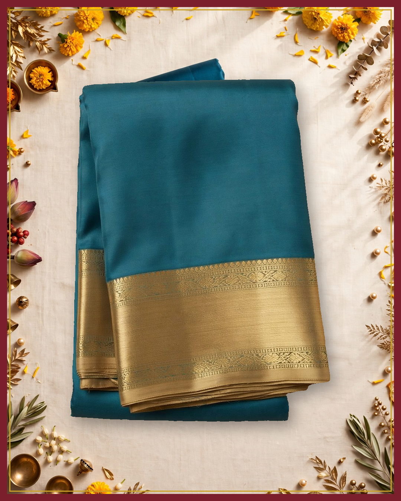
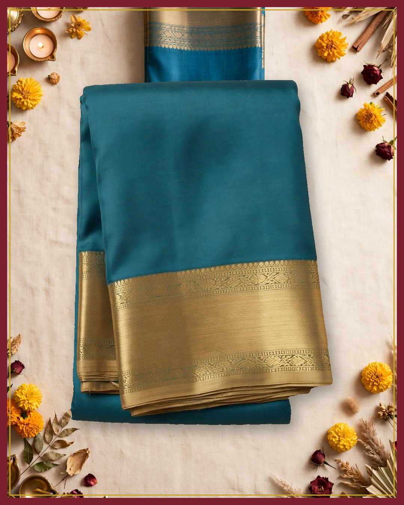
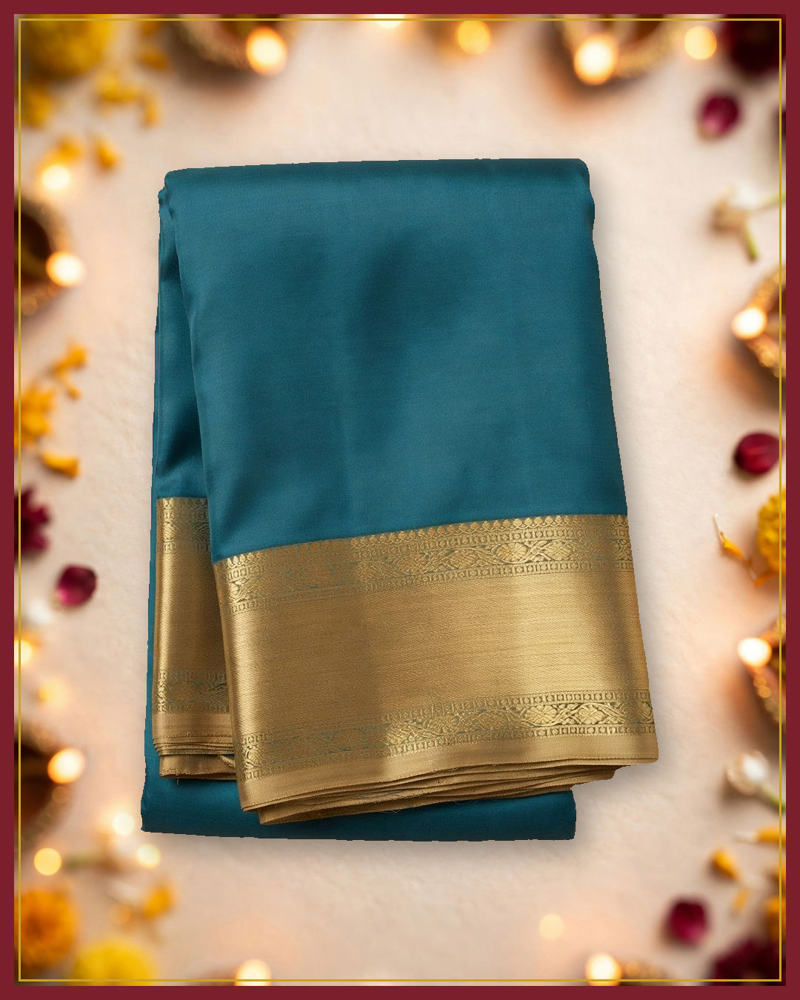
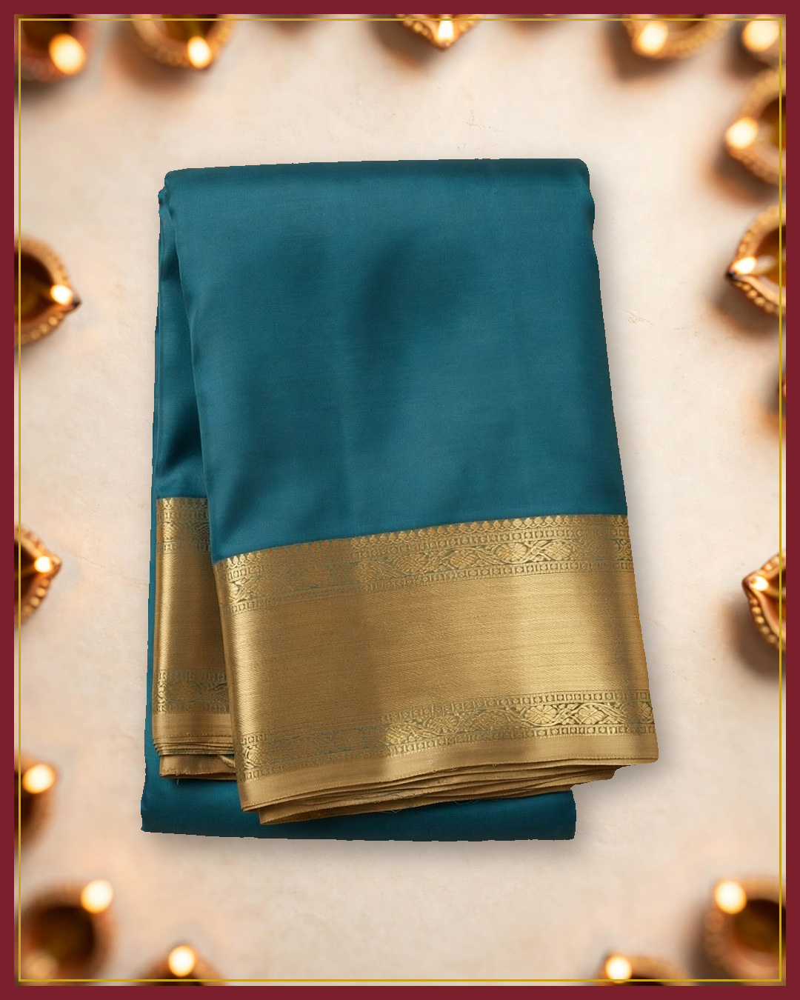

# Campaign for approval: Demo silk saree (synthetic example data)

**Business:** Demo Weaves  
**Brief:** Festive season: introduce this saree  
**Status:** awaiting owner approval. Nothing has been published.

## Images



❌ background shows folded blue saree with gold border in upper center: do not use (mean colour difference 0.0 / 255, saturation 0.192 → 0.192)



❌ background shows folded blue saree at the top center: do not use (mean colour difference 0.0 / 255, saturation 0.192 → 0.192)



✅ product unchanged, background clean (mean colour difference 0.0 / 255, saturation 0.192 → 0.192)



✅ product unchanged, background clean (mean colour difference 0.0 / 255, saturation 0.192 → 0.192)

## Caption variants

### 1. festive glow

Facts used: type, colour

**Instagram**

```
त्योहार की रोशनी में Demo Weaves की नीली हरी शांति

Demo Weaves presents a teal-blue saree with a warm gold border for the festive season. It rests neatly folded, ready for your moments of joy.

Message us on Instagram or Facebook to know more

#DemoWeaves #FestiveSaree #TealBlueSaree #GoldBorder #FestiveElegance
```

**Facebook**

```
त्योहार की रोशनी में Demo Weaves की नीली हरी शांति

Demo Weaves presents a teal-blue saree with a warm gold border for the festive season. It rests neatly folded, ready for your moments of joy.

Message us on Instagram or Facebook to know more

#DemoWeaves #FestiveSaree #TealBlueSaree
```

### 2. quiet elegance

Facts used: type, colour

**Instagram**

```
सादगी में छिपी त्योहारों की शोभा Demo Weaves के संग

This teal-blue saree edged in gold brings quiet grace to festive days from Demo Weaves. It lies neatly folded, simple and serene.

Message us on Instagram or Facebook to know more

#DemoWeaves #SareeLove #TealAndGold #FestiveTradition #ElegantDrape
```

**Facebook**

```
सादगी में छिपी त्योहारों की शोभा Demo Weaves के संग

This teal-blue saree edged in gold brings quiet grace to festive days from Demo Weaves. It lies neatly folded, simple and serene.

Message us on Instagram or Facebook to know more

#DemoWeaves #SareeLove #TealAndGold
```

### 3. warm tradition

Facts used: type, colour

**Instagram**

```
परंपरा की मिठास लिए Demo Weaves की उत्सव भेंट

Demo Weaves shares a teal-blue saree with a glowing gold border for festive gatherings. Folded plainly, its beauty speaks softly.

Message us on Instagram or Facebook to know more

#DemoWeaves #FestiveSeason #TealSaree #TraditionalElegance
```

**Facebook**

```
परंपरा की मिठास लिए Demo Weaves की उत्सव भेंट

Demo Weaves shares a teal-blue saree with a glowing gold border for festive gatherings. Folded plainly, its beauty speaks softly.

Message us on Instagram or Facebook to know more

#DemoWeaves #FestiveSeason #TealSaree
```

## What verification caught

- Round 1: 3 of 3 drafts passed.

## Agent steps (plan, act, observe): 5 turns

1. **analyze_product**: Analyze the product photo first to ground all captions and creatives in its real colours and design  
   → Done. {"observed": {"product_type": "folded saree", "colors": "teal-blue body with gold-toned border", "pattern": "plain solid body with no visible motifs", "border": "wide gold-toned border with intricate patterned bands along top and bottom edges", "styling": "neatly folded and centered on a plain
2. **write_captions**: Draft festive captions using only observed colours and pattern to get 3 verified variants.  
   → Done. 3 of 3 verified captions after 1 rounds.
3. **make_creatives**: Create the first festive campaign image keeping the product unchanged to start the 2 verified images requirement.  
   → FAILED: 0 of 2 images pass. creative_1.png: FAILED (colour difference 0.0; background shows folded blue saree with gold border in upper center); creative_2.png: FAILED (colour difference 0.0; background shows folded blue saree at the top center)
4. **make_creatives**: Retry creatives with background-only description to avoid the duplicate saree that caused failure.  
   → Done. 2 of 2 images pass. creative_3.png: passed (colour difference 0.0); creative_4.png: passed (colour difference 0.0)
5. **submit_campaign**: Submit the completed campaign for owner review because all 3 captions and 2 images are verified  
   → Submitted for owner approval. Nothing is published until the owner approves.

## Questions for the owner

- Can we say: Handwoven?
- whether the gold-toned border is real zari, tested zari or imitation thread
- specific weave origin or technique name
- silk purity, blend, certification, weight and sheerness
- saree length, width, blouse piece inclusion, and care instructions
- price and occasion positioning the seller wants to claim

_Model calls: muse-spark-1.3: 12, muse-image-1.0: 2, sam-3.1: 2. Full trace in trace.jsonl._
