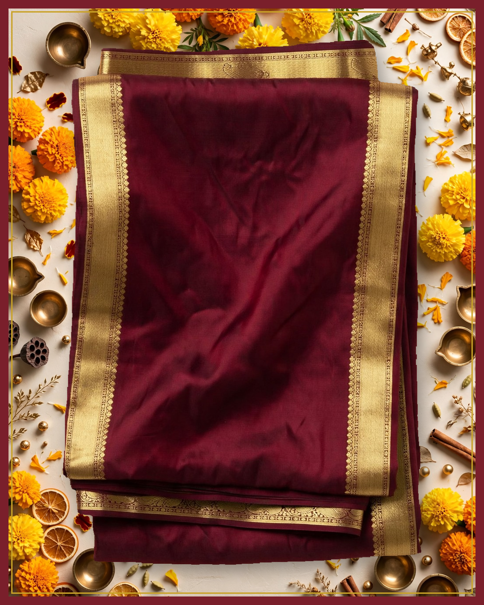
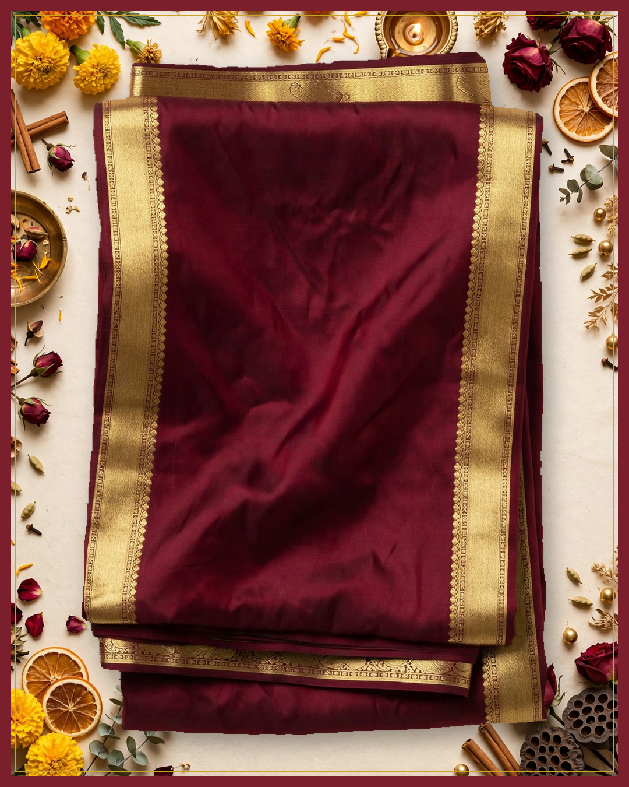
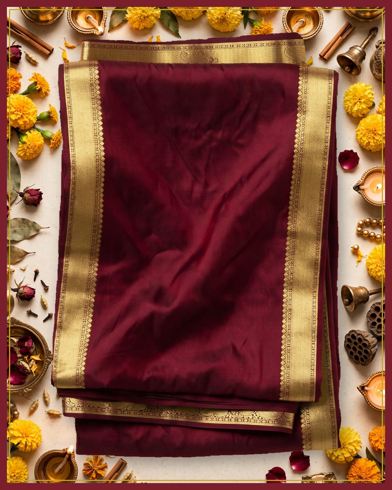
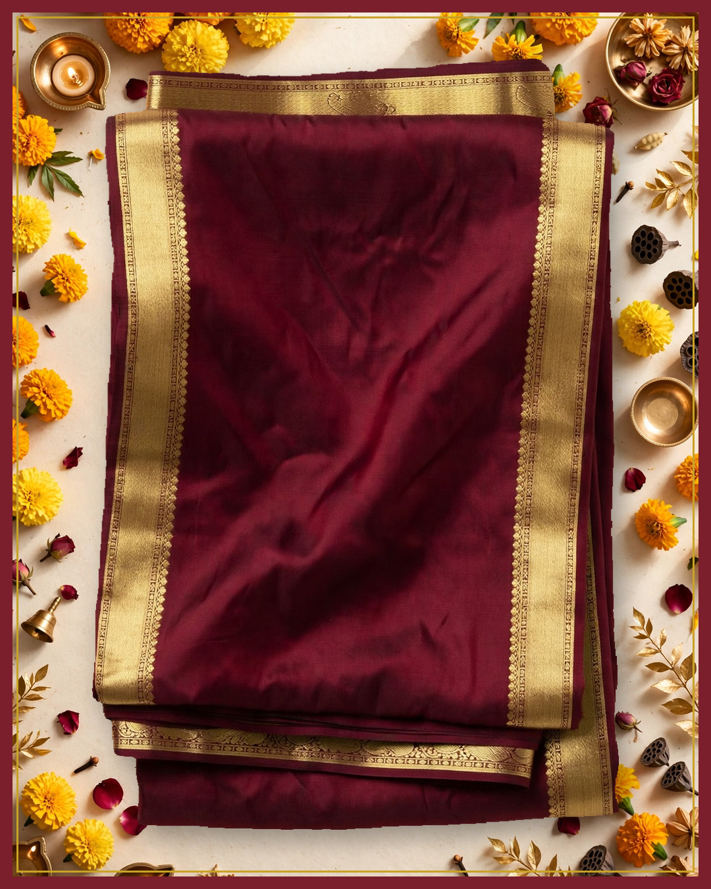

# Campaign for approval: Demo maroon saree (synthetic example data)

**Business:** Demo Weaves  
**Brief:** Festive season: introduce this saree  
**Status:** awaiting owner approval. Nothing has been published.

## Images



✅ product unchanged, background clean (mean colour difference 0.0 / 255, saturation 0.613 → 0.613)



✅ product unchanged, background clean (mean colour difference 0.0 / 255, saturation 0.613 → 0.613)



✅ product unchanged, background clean (mean colour difference 0.0 / 255, saturation 0.613 → 0.613)



✅ product unchanged, background clean (mean colour difference 0.0 / 255, saturation 0.613 → 0.613)

## Caption variants

### 1. festive glow

Facts used: type, colour

**Instagram**

```
त्योहारों की रोशनी में Demo Weaves के साथ दमकिए

Demo Weaves shares a deep maroon saree glowing with a golden border. A warm touch for festive evenings.

Message us on Instagram or Facebook to know more

#MaroonSaree #FestiveLook #GoldBorder #ElegantDrape
```

**Facebook**

```
त्योहारों की रोशनी में Demo Weaves के साथ दमकिए

Demo Weaves shares a deep maroon saree glowing with a golden border. A warm touch for festive evenings.

Message us on Instagram or Facebook to know more

#MaroonSaree #FestiveLook #GoldBorder
```

### 2. quiet celebration

Facts used: type, colour

**Instagram**

```
सादगी में छिपी Demo Weaves की उत्सव शोभा

Demo Weaves celebrates simplicity with this maroon saree edged in gold. Perfect for heartfelt festive moments.

Message us on Instagram or Facebook to know more

#SimpleElegance #MaroonSaree #FestiveVibes #TraditionalCharm
```

**Facebook**

```
सादगी में छिपी Demo Weaves की उत्सव शोभा

Demo Weaves celebrates simplicity with this maroon saree edged in gold. Perfect for heartfelt festive moments.

Message us on Instagram or Facebook to know more

#SimpleElegance #MaroonSaree #FestiveVibes
```

### 3. festive introduction

Facts used: type, colour

**Instagram**

```
त्योहार की रोशनी में खिलती Demo Weaves की गहरी मैरून साड़ी

Demo Weaves welcomes the festive season with a deep maroon saree framed by a wide border in a gold tone. Its quiet glow feels warm and graceful.

Message us on Instagram or Facebook to know more

#DemoWeaves #MaroonSaree #FestiveDrape #SareeLove
```

**Facebook**

```
त्योहार की रोशनी में खिलती Demo Weaves की गहरी मैरून साड़ी

Demo Weaves welcomes the festive season with a deep maroon saree framed by a wide border in a gold tone. Its quiet glow feels warm and graceful.

Message us on Instagram or Facebook to know more

#DemoWeaves #MaroonSaree #FestiveDrape
```

## What verification caught

- Round 1: 2 of 3 drafts passed.
  - Refused: timeless elegance: unsupported claim 'is finished with gold' (Implies material (real gold) and a finishing/manufacturing process. FACTS only support maroon saree with a wide gold border as a feature/colour, and photo only shows gold-colored borders which does not prove material gold or how it was made.)
- Round 2: 1 of 1 drafts passed.

## Agent steps (plan, act, observe): 4 turns

1. **analyze_product**: Analyze the product photo first to ground all captions and creatives in real colours and design  
   → Done. {"observed": {"product_type": "saree", "colors": "deep maroon body with gold-colored borders", "pattern": "solid plain body with no visible motifs on the shown folded portion", "border": "narrow gold-colored borders along the visible edges with fine detailed inner edging", "styling": "neatly f
2. **write_captions**: Write festive-season captions using only observed product facts to get 3 verified variants.  
   → Done. 3 of 3 verified captions after 2 rounds. Refused: timeless elegance: unsupported claim 'is finished with gold' (Implies material (real gold) and a finishing/manufacturing process. FACTS only support maroon saree with a wide gold border as a feature/colour, and photo only shows gold-colored bor
3. **make_creatives**: Create festive campaign images next because captions are verified and 4 verified creatives are still pending.  
   → Done. 4 of 4 images pass. creative_1.png: passed (colour difference 0.0); creative_2.png: passed (colour difference 0.0); creative_3.png: passed (colour difference 0.0); creative_4.png: passed (colour difference 0.0)
4. **submit_campaign**: Submit the completed campaign for owner review since all captions and images are verified  
   → Submitted for owner approval. Nothing is published until the owner approves.

## Questions for the owner

- Can we say: Silk?
- fabric/material composition
- weave technique or saree type
- origin, handmade/handloom status
- length, width, and whether a blouse piece is included
- price, care instructions, and availability

_Model calls: muse-spark-1.3: 13, muse-image-1.0: 1, sam-3.1: 1. Full trace in trace.jsonl._
